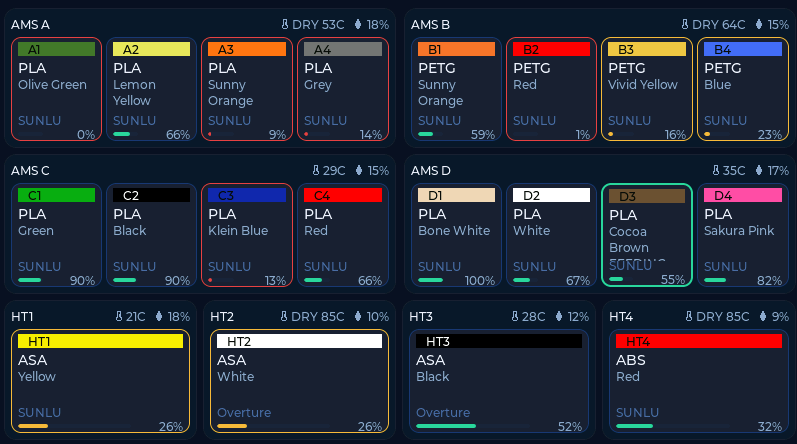
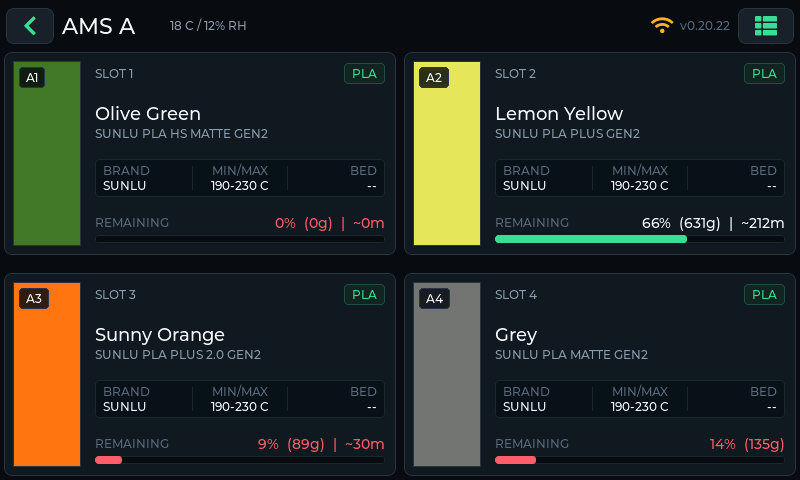

# Digital Swatch System

A touchscreen that shows your Bambu Lab AMS trays as filament swatches, plus live print status, powered by [FilaMan](https://www.filaman.app).

[](https://github.com/wolfrage76/Filaman-Digital-Swatches/releases)
[](https://wolfrage76.github.io/Filaman-Digital-Swatches/)

| AMS overview | AMS slot detail |
|---|---|
|  |  |

## Features

- AMS A–D and AMS-HT trays shown as color swatches with brand, nozzle range, bed temp, and remaining length
- Live print status: state, job, layer, progress, time remaining
- Printer HMS and low-spool alerts
- Browser-based install, on-panel setup, and over-the-air updates
- Web config page with a device log and panel screenshots
- Runs on the Elecrow CrowPanel 7″, the Waveshare ESP32-S3-Touch-LCD-7, and the Guition JC4880P443C 4.3″

## Requirements

- One of the [supported boards](#supported-boards)
- A USB **data** cable
- **Chrome** or **Edge** (for the web flasher)
- **2.4 GHz** Wi‑Fi
- A running FilaMan instance and an **API key** from the FilaMan UI

> [!TIP]
> For live jobs and AMS detail, run [Bambuddy](https://github.com/maziggy/bambuddy) and enable FilaMan's Bambuddy driver. Without a printer driver the panel still links, but trays stay empty.

## Supported boards

| | Elecrow CrowPanel 7″ | Waveshare ESP32-S3-Touch-LCD-7 | Guition JC4880P443C 4.3″ |
|---|---|---|---|
| Screen | 800×480 RGB | 800×480 RGB | 480×800 MIPI, shown as 800×480 |
| Flash | 4 MB | 16 MB | 16 MB |
| USB | CH340 serial adapter. Install the driver if the port is missing. | Native USB. If no port appears, hold **BOOT**, tap **RESET**, release **BOOT**. | USB-Serial/JTAG. Plug into the port that enumerates as a serial device. |
| Address after setup | `http://crowpanel-xxxx.local/` | `http://waveshare-xxxx.local/` | `http://guition-xxxx.local/` |
| Install | Web flasher | Web flasher | Web flasher |
| GitHub update file | `firmware.bin` | `firmware-waveshare-s3-lcd7.bin` | `firmware-guition-jc4880p443.bin` |

> [!CAUTION]
> The three boards share the same screens but **not** the same firmware. Flash only the image for the panel in front of you. The panel refuses an update whose board id does not match.

`xxxx` is the last four hex digits of the panel's Wi‑Fi MAC address, so several panels on one network get different names. **≡ → System** shows the panel's address and hostname.

`firmware.bin` is the same bytes as `firmware-crowpanel-s3-lcd7.bin`. Older CrowPanel firmware still looks for that name.

## Getting started

### 1. Flash

Open the **[Web Flasher](https://wolfrage76.github.io/Filaman-Digital-Swatches/)** and stay inside your board's card. Each card has only that board's USB steps. The Guition card is also where the [C6 radio update](#advanced-guition-c6-radio) is called out; CrowPanel and Waveshare do not have a co-processor.

Pick one:

- **Factory Reset & Install**: first install, or a blank screen.
- **Keep Settings & Update**: a panel that already runs this firmware. If the installer asks to erase, choose **No**.

Then select the serial port, wait until the install reaches 100%, and power-cycle or press reset so the new firmware boots.

### 2. Connect Wi‑Fi and FilaMan

1. On first boot the panel lists nearby networks. Pick yours and enter the password. Wi‑Fi is also under the `≡` menu later.
2. Once Wi‑Fi connects, the panel shows its web address and a QR code. Scan the code with your phone, or open the address in a browser on the same network. **Enter on this display** sets FilaMan from the touchscreen instead.
3. On the config page set:
   - **FilaMan Base URL**, for example `http://192.168.1.50:8083`
   - **FilaMan API Key** (`uak....`)
   - **Printer**, or leave auto-select
   - **OTA / Config Password** if you want this page and wireless updates to require user `admin`
4. Choose **Save**. The panel reboots.

The header Wi‑Fi icon turns green when FilaMan is linked, amber while it is still connecting, and a red `×` when Wi‑Fi itself failed.

Each panel's default **Hostname** ends in part of its MAC address, so panels on one network don't collide. Clear the field to go back to the default. **Answer to .local on the local network (mDNS)** controls the `.local` name. With it off, reach the panel and send wireless updates by IP address.

## Using the panel

- **AMS View** is the home screen. Tap a unit for its trays. The header **←** returns. Tap the printer name to open **Print Status**.
- Swipe between pages, or use **`≡` → SCREENS** for Print Status, AMS View, and Alerts.
- After 60 seconds idle the panel returns to AMS View. Change that under **Display & Alerts**. Those display settings apply immediately.
- **Menu:** Select Printer, Wi‑Fi, FilaMan, MQTT, Display & Alerts, Device, Firmware Update, System.
- The web **Diagnostics** tab shows the device log and can download a screenshot of the panel.

| FilaMan only | FilaMan + Bambuddy |
|---|---|
| Panel links | Same |
| Printer often `offline` or `unknown` | State, job, layer, progress, time remaining |
| Trays empty or static inventory | Live AMS A–D and AMS-HT color, temp, humidity, drying |
| Few alerts | Printer HMS and low-spool alerts |

## Updating

- **On the panel:** Menu → Firmware Update → **Check for updates**. The version comes from GitHub Pages. **Automatically check for updates** is the last control on that screen.
- **From a browser on the LAN:** open `http://<panel-ip>/update` as user `admin` and upload that board's `.bin`.
- **Over USB:** **Keep Settings & Update** for that board on the web flasher.

To test new features early, turn on **Include beta releases** on the panel's Firmware Update screen or on the web config page. The panel then also offers GitHub pre-releases. The web flasher only installs stable releases.

> [!NOTE]
> A panel you flashed from source can be newer than the version published on GitHub. The screen then says you are ahead. That is not a failed check.

## Troubleshooting

- **Blank screen after an update.** Factory Reset & Install for **your** board, power-cycle, then enter Wi‑Fi and FilaMan again.
- **No serial port.** Chrome or Edge only. Try another cable. CrowPanel: CH340 driver. Waveshare: hold **BOOT**, tap **RESET**, release **BOOT**. Guition: use the USB-Serial/JTAG port (`/dev/ttyACM*` on Linux) and flash at 115200.
- **Icon stays amber, trays stay empty.** The FilaMan URL needs `http://` or `https://` and must be reachable from the panel's Wi‑Fi. Check the API key with **Menu → FilaMan → Test connection**, or open Diagnostics.
- **An unplugged AMS-HT is still listed.** FilaMan keeps that slot in its database. Deactivate or remove it there.
- **Two panels answer the same name.** Set a unique Hostname on each config page.

## How it works

```text
Printer → Bambuddy / FilaMan → GET /api/v1/display/printers/{id} → panel
Printer → optional bridge (direct LAN MQTT) → display MQTT → panel
```

The panel polls FilaMan Display API schema v3 every 10 seconds (20 seconds after an error), with `Authorization: ApiKey <key>` and `If-None-Match`.

MQTT is the fallback path. It starts only when the FilaMan URL or key is empty, or the Display API fails twice in a row. The panel then subscribes to `<topic prefix>/#` (default `display/amsview`). The optional publisher in [`bridge/`](bridge/) can fill those topics from Bambuddy, or connect directly to one Bambu printer and read its attached AMS units. Leave it stopped while the FilaMan Display API is reachable.

For direct mode, set `DATA_SOURCE=direct`, `DIRECT_PRINTER_HOST`, `DIRECT_PRINTER_SERIAL`, and `DIRECT_PRINTER_ACCESS_CODE` in `bridge/.env`. The printer must have LAN Only mode enabled. Direct mode provides printer and AMS telemetry, but it has no inventory or queue: third-party spools may lack remaining weight, cost, brand, and color names. Developer Mode is needed only if MQTT controls such as pause or chamber light are used.

## Build from source

Optional. Everyday installs use the web flasher.

Set up PlatformIO in a virtualenv at the repo root (the scripts expect `.venv/bin/pio`):

```bash
python3 -m venv .venv
.venv/bin/pip install platformio
```

| PlatformIO env | Board |
|---|---|
| `crowpanel_7_idf` (default) | Elecrow CrowPanel 7″ |
| `waveshare-s3-lcd7` | Waveshare ESP32-S3-Touch-LCD-7 |
| `guition-jc4880p443` | Guition JC4880P443C 4.3″ (ESP32-P4) |

Build and flash over USB:

```bash
cd firmware
../.venv/bin/pio run -e crowpanel_7_idf -t upload
../.venv/bin/pio run -e waveshare-s3-lcd7 -t upload
../.venv/bin/pio run -e guition-jc4880p443 -t upload
```

The Guition glass is natively portrait. This build rotates it 270° so the same 800×480 UI fills the landscape module. **Menu → Display & Alerts** still flips the picture 180° if the mount is upside down. Wi-Fi is the onboard ESP32-C6, which must run the same ESP-Hosted version as this firmware (**2.9.6**). Factory radios are older. Update the C6 once before you rely on Wi-Fi; see [Advanced: Guition C6 radio](#advanced-guition-c6-radio).

A local build behaves like the public images: set Wi‑Fi and FilaMan on the panel, and they stay in its settings storage across updates.

`include/secrets.h` is optional. Copy `include/secrets.h.example` only if you want compile-time defaults (Wi‑Fi, FilaMan URL, API key, OTA password, hostname) for panels you flash yourself. The first boot of such a build saves those values to the panel. `OTA_HOSTNAME` there replaces the generated default hostname on every image you compile, so leave it out if you flash more than one panel.

### Wireless (OTA) upload

`OTA_PASSWORD` is the panel's **OTA / Config Password**. Leave it unset when the panel has no password.

```bash
cd firmware
# CrowPanel: builds and sends in one step. Reads OTA_PASSWORD from the
# environment, else from secrets.h if present, else sends none.
./ota.sh crowpanel-xxxx.local

# Waveshare
OTA_PASSWORD=yourpass ../.venv/bin/pio run -e waveshare-s3-lcd7_ota -t upload \
  --upload-port waveshare-xxxx.local

# Guition
OTA_PASSWORD=yourpass ../.venv/bin/pio run -e guition-jc4880p443_ota -t upload \
  --upload-port guition-xxxx.local
```

> [!WARNING]
> Flash display-driver changes over USB first. Wireless updates are only safe for UI and logic changes.

### Rebuild the web flasher images

```bash
cd firmware
./webflasher/build_factory.sh
```

This writes the CrowPanel, Waveshare, and Guition images into `docs/firmware/` and copies the CrowPanel app to `firmware.bin`.

> [!IMPORTANT]
> The script refuses to run while `include/secrets.h` exists. Move that file aside first if you keep one.

More detail, including how to add a board: [firmware/FLASHING.md](firmware/FLASHING.md).

## Advanced: Guition C6 radio

The Guition JC4880P443C has no Wi-Fi in the ESP32-P4. The radio is a separate ESP32-C6 on SDIO. This firmware's host stack is ESP-Hosted **2.9.6**. The board usually ships with an older slave (the boot log shows `Slave firmware version: 0.0.0` when the version RPC fails). Leave that mismatch in place and joins drop, SDIO asserts, and the picture can freeze. Display and touch work without the update. Wi-Fi does not stay reliable until the C6 matches.

After a normal boot, the serial log should contain all three:

```text
Host firmware version: 2.9.6
Slave firmware version: 2.9.6
Versions Match!
C6: radio firmware matches host
```

The running app updates the C6 by itself only when the slave reports a real older version (not `0.0.0`). Factory radios fail that check, so use the helper below once. The new C6 image lives in the C6's own flash and survives later P4 reflashes. Settings in the P4's NVS stay if you do not erase the whole chip.

### Update over SDIO (no soldering)

This helper replaces the Digital Swatch app on the P4 until you flash it back. It does not start Wi-Fi. Starting Wi-Fi on the old slave panics the SDIO driver mid-update.

```bash
cd firmware/c6_ota
../../.venv/bin/pio run -t upload
../../.venv/bin/pio device monitor -b 115200
```

Wait for `PASS: C6 radio firmware written`, then restore the panel:

```bash
cd ..
../.venv/bin/pio run -e guition-jc4880p443 -t upload
```

Flash the P4 at **115200**. The USB-Serial/JTAG stub faults if the baud rate changes. The port is the Espressif USB device, `/dev/ttyACM*` on Linux.

### Update over the C6 UART (if the helper prints FAIL)

Wire a 3.3 V USB-TTL adapter to the Expand-IO header **JP1**. Leave the adapter's 3.3 V pin disconnected; the board already powers the C6.

| Adapter | JP1 |
|---|---|
| TX | `C6_U0RXD` |
| RX | `C6_U0TXD` |
| GND | `GND` |

Hold **`C6_IO9` (BOOT)** low and pulse **`C6_CHIP_PU`** if the adapter has no DTR/RTS auto-reset. Halt the P4 first. While Digital Swatch is running it resets the C6 on GPIO 54 and the flash dies mid-write.

```bash
cd firmware
# Park the P4. /dev/ttyACM0 is the P4, not the USB-TTL.
../.venv/bin/python -m esptool --chip esp32p4 --port /dev/ttyACM0 \
  --before default_reset --after no_reset flash_id

curl -LO https://espressif.github.io/arduino-esp32/hosted/esp32c6-v2.9.6.bin

# /dev/ttyUSB0 is the USB-TTL. Use the matching Arduino 2.9.6 image, not an ESPHome 2.12 build.
../.venv/bin/python -m esptool --chip esp32c6 --port /dev/ttyUSB0 --baud 115200 \
  write_flash 0x10000 esp32c6-v2.9.6.bin
../.venv/bin/python -m esptool --chip esp32c6 --port /dev/ttyUSB0 \
  erase_region 0xd000 0x2000

../.venv/bin/python -m esptool --chip esp32c6 --port /dev/ttyUSB0 --after hard_reset flash_id
../.venv/bin/python -m esptool --chip esp32p4 --port /dev/ttyACM0 --after hard_reset flash_id
```

`erase_region 0xd000 0x2000` clears the C6 otadata so it boots the slot just written at `0x10000`.

Full pin and command notes: [firmware/FLASHING.md](firmware/FLASHING.md#advanced-update-the-guition-esp32-c6).

## Project layout

| Path | What it is |
|---|---|
| `docs/` | GitHub Pages web flasher and firmware binaries |
| `firmware/` | Firmware for the CrowPanel, Waveshare, and Guition boards |
| `bridge/` | Optional Bambuddy/direct-printer → MQTT publisher |
| `firmware/FLASHING.md` | Flash matrix, GitHub update files, publish checklist |

> [!NOTE]
> The GitHub repository is still named [Filaman-Digital-Swatches](https://github.com/wolfrage76/Filaman-Digital-Swatches). Installed panels check its Pages site for updates, so the repo address stays.
