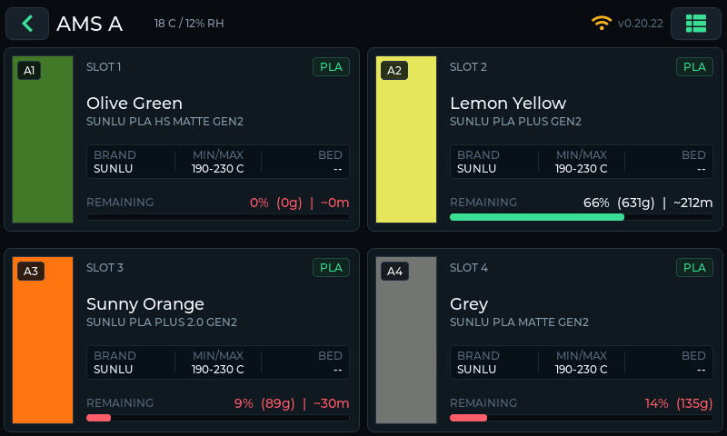

# Digital Swatch System

A 7″ touchscreen for Bambu Lab AMS trays and print status. The panel talks to [FilaMan](https://www.filaman.app). It runs on two ESP32-S3 boards. They share the same screens and they do not share firmware.

**Firmware** `0.21.3` · [Web Flasher](https://wolfrage76.github.io/Filaman-Digital-Swatches/) · [Releases](https://github.com/wolfrage76/Filaman-Digital-Swatches/releases)

The GitHub repository is still [Filaman-Digital-Swatches](https://github.com/wolfrage76/Filaman-Digital-Swatches). Panels already installed check that Pages site for updates, so the repo address stays.




## Pick your board

Flash only the section that matches the panel in front of you. A CrowPanel image will not run on a Waveshare, and the other way around. The panel refuses an update whose board id does not match.

| | Elecrow CrowPanel 7″ | Waveshare ESP32-S3-Touch-LCD-7 |
|---|---|---|
| Screen | 800×480 RGB | 800×480 RGB |
| Flash | 4 MB | 16 MB |
| USB | CH340 serial adapter. Install the driver if the port is missing. | Native USB. If no port appears, hold **BOOT**, tap **RESET**, release **BOOT**. |
| Web flasher | CrowPanel section | Waveshare section |
| After setup | `http://crowpanel-xxxx.local/` | `http://waveshare-xxxx.local/` |
| GitHub update file | `firmware.bin` | `firmware-waveshare-s3-lcd7.bin` |

`xxxx` is the last four hex digits of the panel's Wi‑Fi MAC address, so several panels on one network get different names. **≡ → System** shows the panel's address and hostname.

`firmware.bin` is the same bytes as `firmware-crowpanel-s3-lcd7.bin`. Older CrowPanel firmware still looks for that name.

You also need a USB **data** cable, **Chrome** or **Edge**, **2.4 GHz** Wi‑Fi, and a FilaMan **API key** from the FilaMan UI.

For live jobs and AMS detail, run [Bambuddy](https://github.com/maziggy/bambuddy) and enable FilaMan’s Bambuddy driver. Without a printer driver, the panel can link and still show empty trays.

## Flash

Open the flasher and stay inside your board’s card.

### [Open the Web Flasher](https://wolfrage76.github.io/Filaman-Digital-Swatches/)

1. **First time, or a blank screen:** **Factory Reset & Install**.
2. **Update a panel that already runs this firmware:** **Keep Settings & Update**. If the installer asks to erase, choose **No**.
3. Select the serial port and wait until the install reaches 100%.
4. Power-cycle or press reset so the new firmware boots.

## Connect Wi‑Fi and FilaMan

1. On first boot the panel lists nearby networks. Pick yours and enter the password. Wi‑Fi is also under the `≡` menu later.
2. Once Wi‑Fi connects, the panel shows its web address and a QR code. Scan the code with your phone, or open the address in a browser on the same network. **Enter on this display** sets FilaMan from the touchscreen instead.
3. On the config page set:
   - **FilaMan Base URL**, for example `http://192.168.1.50:8083`
   - **FilaMan API Key** (`uak....`)
   - **Printer**, or leave auto-select
   - **OTA / Config Password** if you want this page and wireless updates to require user `admin`
4. Choose **Save**. The panel reboots.

The header Wi‑Fi icon turns green when FilaMan is linked, amber while it is still connecting, and a red `×` when Wi‑Fi itself failed.

Each panel's default **Hostname** ends in part of its MAC address, so panels on one network don't collide. Clear the field to go back to the default.

## What you see

- **AMS View** is the home screen. Tap a unit for its trays. The header **←** returns. Tap the printer name to open **Print Status**.
- Swipe between pages, or use **`≡` → SCREENS** for Print Status, AMS View, and Alerts.
- After 60 seconds idle the panel returns to AMS View. Change that under **Display & Alerts**. Those display settings apply immediately.
- **Menu:** Select Printer, Wi‑Fi, FilaMan, MQTT, Display & Alerts, Device, Firmware Update, System.
- The web **Diagnostics** tab shows the device log and can download a screenshot of the panel.

| FilaMan only | FilaMan + Bambuddy |
|---|---|
| Panel links | Same |
| Printer often `offline` or `unknown` | State, job, layer, progress, time remaining |
| Trays empty or static inventory | Live AMS A–D and AMS-HT color, temp, humidity, drying |
| Few alerts | Printer HMS and low-spool alerts |

## Update later

- **On the panel:** Menu → Firmware Update → **Check for updates**. The version comes from GitHub Pages. **Automatically check for updates** is the last control on that screen.
- **From a browser on the LAN:** open `http://<panel-ip>/update` as user `admin` and upload that board’s `.bin`.
- **Over USB:** **Keep Settings & Update** for that board on the web flasher.

A panel you flashed from source can be newer than the version published on GitHub. The screen then says you are ahead. That is not a failed check.

## Troubleshooting

- **Blank screen after an update.** Factory Reset & Install for **your** board, power-cycle, then enter Wi‑Fi and FilaMan again.
- **No serial port.** Chrome or Edge only. Try another cable. CrowPanel: CH340 driver. Waveshare: hold **BOOT**, tap **RESET**, release **BOOT**.
- **Icon stays amber, trays stay empty.** The FilaMan URL needs `http://` or `https://` and must be reachable from the panel’s Wi‑Fi. Check the API key with **Menu → FilaMan → Test connection**, or open Diagnostics.
- **An unplugged AMS-HT is still listed.** FilaMan keeps that slot in its database. Deactivate or remove it there.
- **Two panels answer the same name.** Set a unique Hostname on each config page.

## Build from source

Optional. Everyday installs use the web flasher.

```text
Printer → Bambuddy / FilaMan → GET /api/v1/display/printers/{id} → panel
```

The panel polls FilaMan Display API schema v3 every 10 seconds (20 seconds after an error), with `Authorization: ApiKey <key>` and `If-None-Match`. MQTT starts only when the FilaMan URL or key is empty, or the Display API fails twice in a row.

| PlatformIO env | Board |
|---|---|
| `crowpanel_7_idf` (default) | Elecrow CrowPanel 7″ |
| `waveshare-s3-lcd7` | Waveshare ESP32-S3-Touch-LCD-7 |

```bash
cd firmware
../.venv/bin/pio run -e crowpanel_7_idf -t upload
../.venv/bin/pio run -e waveshare-s3-lcd7 -t upload
```

A local build behaves like the public images: set Wi‑Fi and FilaMan on the panel, and they stay in its settings storage across updates.

`include/secrets.h` is optional. Copy `include/secrets.h.example` only if you want compile-time defaults (Wi‑Fi, FilaMan URL, API key, OTA password, hostname) for panels you flash yourself. The first boot of such a build saves those values to the panel. `OTA_HOSTNAME` there replaces the generated default hostname on every image you compile, so leave it out if you flash more than one panel.

`./ota.sh` builds and sends the **CrowPanel** image only. It uses `OTA_PASSWORD` from the environment, or from `secrets.h` if present, or no password. For Waveshare:

```bash
OTA_PASSWORD=yourpass ../.venv/bin/pio run -e waveshare-s3-lcd7_ota -t upload \
  --upload-port waveshare-xxxx.local
```

Leave `OTA_PASSWORD` unset when the panel has no password.

Rebuild the pages images with the script below. It writes both boards into `docs/firmware/` and copies the CrowPanel app to `firmware.bin`. It refuses to run while `include/secrets.h` exists, so move that file aside first if you keep one.

```bash
cd firmware
./webflasher/build_factory.sh
```

More detail, including how to add a board: [firmware/FLASHING.md](firmware/FLASHING.md).

MQTT is the fallback path. The panel subscribes to `<topic prefix>/#` (default `display/amsview`). The optional publisher in [`bridge/`](bridge/) can fill those topics from Bambuddy. Leave it stopped while the Display API is reachable.

| Path | What it is |
|---|---|
| `docs/` | GitHub Pages web flasher and firmware binaries |
| `firmware/` | ESP32-S3 firmware for both boards |
| `bridge/` | Optional Bambuddy → MQTT publisher |
| `firmware/FLASHING.md` | Flash matrix, GitHub update files, publish checklist |
