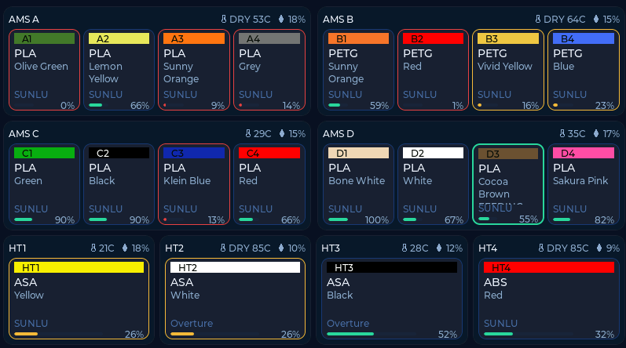

# Filaman Digital Swatches

A 7″ touchscreen AMS and printer dashboard for Bambu Lab printers, built for the **Elecrow CrowPanel 7″ (ESP32-S3)** and powered by **FilaMan’s Display API**.

**Firmware:** `0.20.22` · **[Web Flasher](https://wolfrage76.github.io/Filaman-Digital-Swatches/)** · **[Releases](https://github.com/wolfrage76/Filaman-Digital-Swatches/releases)**



---

## Before you start

You need:

- **Elecrow CrowPanel 7″** (ESP32-S3, 800×480 RGB)
- **USB data cable** (not charge-only) + **Chrome** or **Edge** on your computer
- **2.4 GHz Wi‑Fi**
- **[FilaMan](https://www.filaman.app)** running on your network, with an **API key** created in the FilaMan UI

Optional, but recommended for live printer and AMS detail:

- **[Bambuddy](https://github.com/maziggy/bambuddy)** + FilaMan’s **Bambuddy driver** (see step 3 below)

---

## Quick start (no command line)

### Step 1 — Flash the panel from your browser

Open the Web Flasher in **Chrome** or **Edge**:

### 👉 [Open the Filaman Digital Swatches Web Flasher](https://wolfrage76.github.io/Filaman-Digital-Swatches/)

1. Install the **CH340** USB-serial driver if your OS asks for one.
2. Plug the CrowPanel into your computer over USB.
3. Pick an option on the page:
   - **First time (or blank screen):** click **Factory Reset & Install**
   - **Updating an existing panel:** click **Keep Settings & Update** *(if asked to erase, choose **No**)*
4. Select the CrowPanel serial port and wait for the install to reach 100%.
5. Unplug/replug USB (or press Reset) so the panel boots into the new firmware.

---

### Step 2 — Connect Wi‑Fi and FilaMan

1. **Wi‑Fi:** On first boot, pick your network on the touchscreen and enter the password (you can also reach Wi‑Fi anytime from the `≡` menu).
2. **Find the panel on your network:** once connected, open **http://crowpanel.local/** in a browser (or use the IP address shown in the panel’s Wi‑Fi menu).
   - If you have **more than one panel**, give each one its own **Hostname** on that page (for example `crowpanel-h2d`, `crowpanel-h2c`) so they don’t collide on `crowpanel.local`.
3. **Link FilaMan:** on the config page, fill in:
   - **FilaMan Base URL** — e.g. `http://192.168.1.50:8083`
   - **FilaMan API Key** — `uak....` from FilaMan
   - **Printer** — pick the printer to watch, or leave auto-select
   - **OTA / Config Password** — optional; sets the `admin` password for this page
4. Click **Save**.

Within ~10–15 seconds the header badge changes from `FilaMan...` to **`Live`**.

---

### Step 3 — (Recommended) Add Bambuddy for full AMS & job data

The panel only talks to **FilaMan**. If FilaMan has no printer driver feeding it, the panel still connects (`Live`), but printer state and AMS trays will look empty or offline.

For the full dashboard shown in the screenshot:

1. Run **[Bambuddy](https://github.com/maziggy/bambuddy)** on your LAN and connect your Bambu printer(s).
2. In **FilaMan**, install/enable the **Bambuddy** plugin and add each printer using the Bambuddy driver.
3. Assign your spools to AMS slots in FilaMan so **brand, color name, finish, and remaining weight** appear on the digital swatches.

| FilaMan only | FilaMan + Bambuddy |
|---|---|
| Panel links to FilaMan (`Live`) | Same |
| Printer often `offline` / `unknown` | Live state, print job, layer, progress, ETA |
| AMS trays empty or static inventory only | Live AMS A–D + AMS-HT swatches, temps, humidity, drying |
| Few or no alerts | Printer HMS + low-spool alerts |

---

### Step 4 — Everyday use & updates

- **Navigate:** tap the footer (`Print · All · A · B · C · D · HT · Alrt`) or swipe left/right. After ~60 s idle, the screen returns to **Print** (unless you’re viewing active alerts).
- **Menu (`≡`):** change printer, Wi‑Fi, FilaMan URL/key, screen dim/off timers, or device hostname on the panel itself.
- **Easy updates later:**
  - **Over Wi‑Fi:** open `http://crowpanel.local/update` (user `admin`, password = your OTA password) and upload a `.bin`, *or*
  - **Over USB:** use **Keep Settings & Update** on the [Web Flasher](https://wolfrage76.github.io/Filaman-Digital-Swatches/).

---

## Troubleshooting

- **Blank screen after an update** — Open the [Web Flasher](https://wolfrage76.github.io/Filaman-Digital-Swatches/), run **Factory Reset & Install**, power-cycle the panel, then re-enter Wi‑Fi and FilaMan at `http://crowpanel.local/`.
- **Serial port doesn’t show up in the browser** — Use Chrome or Edge (not Firefox/Safari), try another USB cable (many cables are power-only), and install a CH340 driver.
- **Header stays on `FilaMan...` or `Stale`** — Check that the FilaMan URL starts with `http://` or `https://`, is reachable from the panel’s Wi‑Fi VLAN, and the `uak....` API key is valid.
- **An old AMS-HT still appears after unplugging it** — FilaMan keeps previously discovered AMS slots active in its database; deactivate or remove that slot on the printer in FilaMan.
- **Two panels behave strangely on the network** — Give each panel a unique **Hostname** on its web config page (`http://<panel-ip>/`).

---

## Advanced (developers & CLI)

Everything below is optional — only needed if you want to compile from source, use PlatformIO, or run the legacy MQTT fallback.

### Data flow

```text
Printer → Bambuddy / FilaMan → GET /api/v1/display/printers/{id} → CrowPanel
```

- Polls FilaMan Display API (**schema v3**) every **10 s** (20 s backoff on error) with `Authorization: ApiKey <key>` and `If-None-Match` / `304` support.
- **MQTT is fallback-only:** starts only if FilaMan URL/key is empty or the Display API fails **twice** in a row. Once Display API succeeds again, MQTT stops being serviced.

### Build & flash with PlatformIO

Daily environment: **`crowpanel_7_idf`** (Arduino 3 / ESP-IDF 5.3, bounce buffers, SPIRAM XIP, configured as `default_envs`).

```bash
cd firmware
cp include/secrets.h.example include/secrets.h
# edit include/secrets.h with your Wi-Fi, FilaMan URL/key, and OTA password
../.venv/bin/pio run -e crowpanel_7_idf -t upload
```

Example `firmware/include/secrets.h`:

```cpp
#define WIFI_SSID "your-wifi"
#define WIFI_PASSWORD "your-password"
#define FILAMAN_BASE_URL "http://filaman.local:8083"
#define FILAMAN_API_KEY "uak...."
#define FILAMAN_PRINTER_ID 0
#define OTA_HOSTNAME "crowpanel"
#define OTA_PASSWORD "change-me"
```

### Command-line Wi‑Fi OTA

Prefer the Web Flasher or `/update` for normal use. For scripted pushes during development:

```bash
cd firmware
./ota.sh                 # default: crowpanel.local
./ota.sh 192.168.1.164   # or panel IP
```

Or via PlatformIO directly:

```bash
OTA_PASSWORD=yourpass ../.venv/bin/pio run -e crowpanel_7_idf_ota -t upload \
  --upload-port crowpanel.local
```

More flashing and partition notes: [firmware/FLASHING.md](firmware/FLASHING.md).

### Rebuilding the GitHub Pages Web Flasher images

`build_factory.sh` refuses to run while `firmware/include/secrets.h` is present so personal Wi‑Fi / API keys are never baked into `docs/firmware/`:

```bash
cd firmware
mv include/secrets.h include/secrets.h.local   # if present
./webflasher/build_factory.sh
mv include/secrets.h.local include/secrets.h
```

This writes both the full factory image (`factory.bin`) and the split keep-settings parts (`bootloader.bin`, `partitions.bin`, `boot_app0.bin`, `firmware.bin`) into `docs/firmware/`.

### Optional MQTT fallback & bridge

When fallback triggers, the panel subscribes to `<topic prefix>/#` (default `display/amsview`). The optional Python publisher in [`bridge/`](bridge/) can feed those retained topics from Bambuddy — set `DISPLAY_TOPIC_PREFIX=display/amsview` in `bridge/.env` so it matches the firmware default. Leave the bridge stopped when FilaMan’s Display API is reachable.

### Repo layout

| Path | Purpose |
|---|---|
| `docs/` | GitHub Pages Web Flasher (ESP Web Tools + firmware binaries) |
| `firmware/` | ESP32-S3 / LVGL firmware (`crowpanel_7_idf`) |
| `bridge/` | Optional Bambuddy → MQTT publisher for fallback mode |
| `display-api-llm-brief.md` | FilaMan Display API (schema v3) reference |
| `firmware/FLASHING.md` | Partition layout, envs, and QA checklist |
